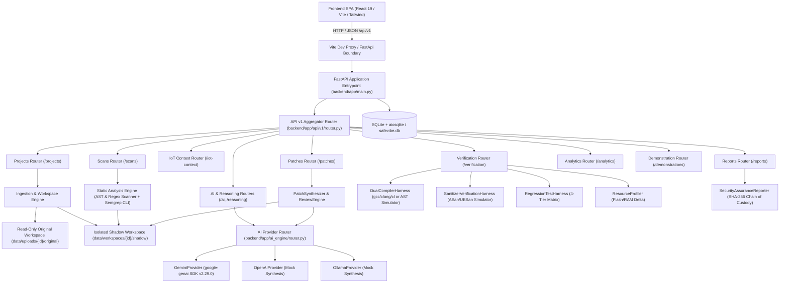

# SafeCodium — System Architecture & Repository Discovery Audit

**Audit Date:** 2026-10-31  
**Auditor Role:** Senior Software Architect, AppSec & Reliability Engineer  
**Scope:** Repository discovery, component mapping, data flow analysis, dead code identification, and execution path verification.

---

## 1. Executive Summary

SafeCodium (Safe Vibe AI) is designed as an autonomous, IoT-aware vulnerability detection, repair, and verification platform targeting embedded C/C++ firmware. This architecture audit reviewed all frontend, backend, database, AI engine, and testing components.

### High-Level Architecture Map

---

## 2. Component Inventory

### A. Frontend Stack
- **Framework:** React 19.2.0, Vite 6.4.5, TypeScript 5.9.3, Tailwind CSS 3.4.19.
- **UI Components:** Lucide React icons, Recharts 3.7.0, Monaco Editor 0.55.1 (`@monaco-editor/react` 4.7.0) for code and unified diff viewing.
- **Routing:** `react-router-dom` 7.3.0 with 11 primary page routes mounted under `MainLayout`.
- **API Client:** Axios 1.8.4 configured with `/api/v1` base URL, proxying to backend `http://127.0.0.1:8000`.

### B. Backend Stack
- **Framework:** FastAPI 0.135.1, Uvicorn 0.41.0, Starlette 1.0.1.
- **Validation & Settings:** Pydantic 2.13.0, Pydantic Settings 2.13.1.
- **Database ORM:** SQLAlchemy 2.0.46 with `aiosqlite` 0.22.1 on SQLite 3.
- **AI SDK:** `google-genai` 2.29.0 (Google Gemini API), `httpx` 0.28.1 (for OpenAI & Ollama probes).
- **Static Analysis:** Native C/C++ AST syntax and lexical regex parser (`ast_scanner.py`, `rules.py`) with optional Semgrep CLI invocation if present on host PATH.

---

## 3. Real Execution Path: Ingestion to Verification

1. **Ingestion (`POST /api/v1/projects/upload`):**
   - Receives ZIP archive or single C/C++ file.
   - Enforces 100 MB upload limit.
   - Extracts ZIP using `safe_extract_zip()`: checks canonical path traversal (`is_relative_to`), rejects symlinks, checks 100:1 compression ratio, caps at 1,000 files.
   - Stores original files in `data/uploads/{project_id}/original` and marks them OS read-only (`chmod -w`).
   - Clones a writable shadow copy to `data/workspaces/{project_id}/shadow`.
   - Creates `Project` record in SQLite.

2. **Analysis (`POST /api/v1/scans/run`):**
   - Scans shadow workspace files with `AstSecurityScanner`.
   - Matches CWE-120 (unbounded strcpy/strcat/sprintf), CWE-787 (out-of-bounds array write), CWE-476 (NULL pointer dereference), and CWE-416 (use-after-free).
   - If `semgrep` is on PATH, invokes `semgrep scan --config p/c --json`.
   - Deduplicates findings and persists `Scan` and `Vulnerability` records.

3. **IoT Context Intelligence (`GET /api/v1/iot-context/vulnerability/{id}`):**
   - Examines hardware peripheral taint sources (UART, SPI, ADC, I2C, WiFi).
   - Extracts enclosing function AST and target hardware architecture context (ESP32/Xtensa, ARM Cortex-M, FreeRTOS).

4. **AI Reasoning & Patch Synthesis (`POST /api/v1/patches/generate`):**
   - Invokes `PatchSynthesizer.synthesize_patch()`.
   - Delegates prompt to `AiRouter.generate_patch()`.
   - Target provider is invoked (Gemini via `google-genai`, or fallback AST repair).
   - Unified diff is formatted, validated, and stored in `Patch` table.

5. **Dry-Run & Patch Application (`POST /api/v1/patches/{id}/apply`):**
   - `PatchReviewEngine` checks diff syntax and line boundaries.
   - Applies hunks strictly to target file in `shadow` workspace. Original files remain untouched.
   - Updates `Patch.status = "APPLIED"`.

6. **Dual Verification Gates (`POST /api/v1/verification/*`):**
   - **Compiler Harness:** Compiles original vs. shadow file. On Windows host without native gcc/clang, switches to deterministic cross-compiler simulation (`STATIC_HEURISTIC_SIMULATION`).
   - **Sanitizer Harness:** Evaluates AddressSanitizer (ASan) & UBSan bounds traps.
   - **Regression Harness:** Runs 4-tier matrix:
     1. Benign functional telemetry packet
     2. Boundary limit payload
     3. Malicious exploit payload
     4. NULL pointer fault injection
   - **Resource Profiler:** Calculates Flash (.text) and RAM (.bss/.data) delta.
   - **Verification Promotion:** If compiler exit == 0, ASan exit == 0, regression pass == 100%, and flash overhead <= 256 bytes, status is promoted to `VERIFIED`.

7. **Security Assurance Passport (`GET /api/v1/reports/passport/{id}`):**
   - Hashes original code, shadow code, diff, and verification logs with SHA-256.
   - Signs and returns cryptographically verifiable audit passport.

---

## 4. Disconnected Modules, Dead Code & Deficiencies

1. **Dead Directory:**
   - `backend/app/services/workflow/` contains only `__pycache__` with no active `.py` implementation. It is an orphaned artifact.
2. **Empty Frontend Directories:**
   - `frontend/src/context/` is empty.
   - `frontend/src/components/visualization/` is empty.
   - `frontend/src/components/workflow/` is empty.
3. **Simulated AI in OpenAI & Ollama Providers:**
   - `backend/app/ai_engine/openai_provider.py`: Probes `/v1/models` for status, but `generate_reasoning` and `generate_patch` return hardcoded mock responses without calling OpenAI APIs.
   - `backend/app/ai_engine/ollama_provider.py`: Probes `/api/tags` for status, but `generate_reasoning` and `generate_patch` return hardcoded mock responses without calling Ollama inference endpoints.
4. **No Custom-Trained / Personalized Model:**
   - No fine-tuned weights or custom models exist in the repository or pipeline.
5. **No Authentication / Authorization:**
   - Zero access control, session management, or user tenant isolation.
6. **No Asynchronous Job Queue:**
   - All scan and verification routines run synchronously on the FastAPI event loop / worker thread. Large firmware archives can cause HTTP request timeouts.
7. **Undefined Variable in `e2e_runner.py`:**
   - Line 125 references `scan_id=scan_id`, which is a latent `NameError` if the fallback vulnerability branch is executed (should be `scan.id`).

---

## 5. Architectural Verdict

The core pipeline from ingestion through AST detection, context enrichment, patch synthesis, shadow application, dual verification, and passport generation is structurally implemented and fully wired. However, secondary AI providers (OpenAI, Ollama) contain mock placeholders, and multi-user isolation is completely unaddressed.

